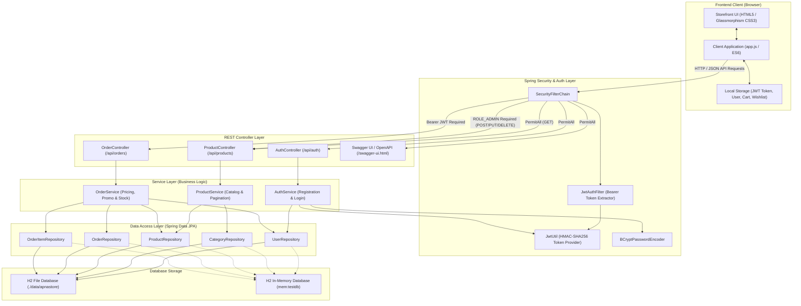
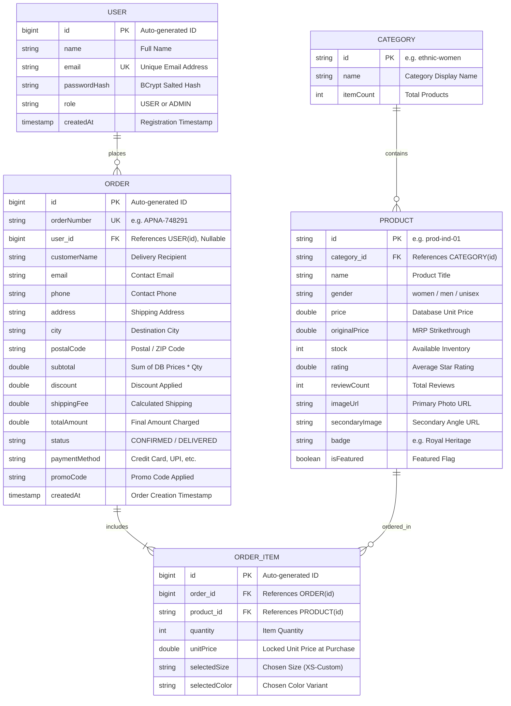

# Apna Store — Royal Couture E-Commerce Platform

[](https://github.com/mdshakeel-lab/ApnaStore/actions/workflows/ci.yml)


A production-grade, full-stack luxury ethnic couture e-commerce platform built with **Java 17**, **Spring Boot 3.2**, **Spring Security (Stateless JWT)**, **Spring Data JPA**, **H2 Database**, **SpringDoc OpenAPI (Swagger UI)**, and a responsive **Glassmorphism Vanilla JavaScript (ES6+)** frontend.

---

## 🌟 Overview & Feature List

- **Full-Stack Single-Port Delivery**: Spring Boot serves both the high-performance REST API and the static web storefront (`index.html`, `styles.css`, `app.js`) on port `8080`.
- **Interactive Swagger UI & OpenAPI 3**: Complete interactive API documentation at `/swagger-ui.html` with built-in **"Authorize"** Bearer JWT authentication support.
- **Stateless Authentication with JWT**: Secure registration and login using BCrypt password hashing (`BCryptPasswordEncoder`) and signed HMAC-SHA256 JWT tokens via JJWT 0.12.
- **Role-Based Access Control (RBAC)**: Public browsing, customer-authenticated checkout (`POST /api/orders`) and personal order history (`GET /api/orders/my`), and admin-restricted catalog modifications (`ROLE_ADMIN`).
- **Server-Side Pricing & Inventory Integrity**: Item totals are calculated strictly against verified database prices (frontend prices are ignored), coupled with transactional stock deduction (`@Transactional`) that raises `InsufficientStockException` on insufficient inventory.
- **Promotional Discount Engine**: Validates discount codes on the server (`APNA20` for 20% off, `WELCOME10` for 10% off, `VIP50` for flat ₹50 off, and free shipping over ₹300).
- **Automated Database Seeding**: Pre-populates 9 luxury ethnic couture items, category hierarchies, and a default administrative account on boot if tables are empty.
- **Dual H2 Profiles**: Persistent file-based storage for local development (`./data/apnastore`) and an isolated, fast in-memory database (`jdbc:h2:mem:testdb`) for the test profile.
- **Glassmorphism Storefront UI**: Bespoke luxury aesthetic with dark/light mode toggle, category filtering, instant keyword search, quick-view modals, persistent cart & wishlist via `localStorage`, and customer order history view.
- **100% Automated Testing**: Unit tests with JUnit 5 & Mockito, WebMvc slice tests with MockMvc, and full end-to-end integration flows.
- **GitHub Actions CI Pipeline**: Automated Maven compilation and test suite verification on every push and pull request to `main`.

---

## 🛠 Tech Stack

| Layer | Technologies |
|---|---|
| **Backend Framework** | Java 17, Spring Boot 3.2.3, Spring MVC, Spring Data JPA, Hibernate ORM |
| **Security & Auth** | Spring Security 6, JJWT (io.jsonwebtoken 0.12.6), BCrypt Password Hashing |
| **API Documentation** | SpringDoc OpenAPI 3 (`springdoc-openapi-starter-webmvc-ui` 2.3.0), Swagger UI |
| **Databases** | H2 Embedded Database (File mode for dev persistence; In-memory for tests) |
| **Validation** | Jakarta Bean Validation (`spring-boot-starter-validation`, Hibernate Validator) |
| **Build & CI/CD** | Apache Maven 3.9, Maven Wrapper (`mvnw` / `mvnw.cmd`), GitHub Actions CI |
| **Automated Testing** | JUnit 5 Jupiter, Mockito, Spring Boot Starter Test, Spring Security Test, MockMvc |
| **Frontend** | Vanilla JavaScript (ES6+), HTML5, CSS3 Custom Properties (Glassmorphism), Font Awesome 6.5, Google Fonts (*Cinzel*, *Plus Jakarta Sans*) |

---

## 🏛 System Architecture



---

## 🗄 Entity Relationship (ER) Diagram



---

## 📡 REST API Reference

| Method | Endpoint | Access | Description |
|---|---|---|---|
| `POST` | `/api/auth/register` | **Public** | Register a new user account and receive a JWT token |
| `POST` | `/api/auth/login` | **Public** | Authenticate credentials and receive a JWT token |
| `GET` | `/api/products` | **Public** | List products (supports `category`, `q`, `page`, `size`, `sort`) |
| `GET` | `/api/products/{id}` | **Public** | Retrieve single product details by ID |
| `GET` | `/api/products/categories` | **Public** | Retrieve category listing and item counts |
| `POST` | `/api/orders` | **Bearer Token** | Submit an order; validates stock, prices from DB, applies promo |
| `GET` | `/api/orders/{id}` | **Bearer Token** | Look up order status by order number or numeric ID |
| `GET` | `/api/orders/my` | **Bearer Token** | Fetch all orders belonging to the logged-in user |
| `POST` | `/api/products` | **Admin Only** | Add a new product to the catalog |
| `PUT` | `/api/products/{id}` | **Admin Only** | Update an existing product |
| `DELETE` | `/api/products/{id}` | **Admin Only** | Delete a product from the catalog |
| `GET` | `/swagger-ui.html` | **Public** | Interactive Swagger UI API documentation |
| `GET` | `/v3/api-docs` | **Public** | OpenAPI 3 JSON specification |

---

## 🚀 Getting Started

### Prerequisites
- **Java JDK 17** or newer installed (`java -version`)
- Git installed (`git --version`)

### 1. Configure Environment Variables
Copy `.env.example` to `.env` or set environment variables in your terminal:

```bash
# Copy template
cp .env.example .env
```

Environment variables supported by `application-dev.properties` and `application-prod.properties`:

| Variable | Description | Default (Dev Profile) |
|---|---|---|
| `APNASTORE_JWT_SECRET` | Secret key for signing HMAC-SHA256 tokens ($\ge 64$ chars) | Built-in dev fallback |
| `APNASTORE_JWT_EXPIRY_MS` | JWT expiration duration in milliseconds | `86400000` (24 hours) |
| `ADMIN_SEED_PASSWORD` | Password for the auto-seeded `admin@apnastore.com` account | `Admin@Store2026` |
| `DB_URL` / `DB_USERNAME` / `DB_PASSWORD` | External MySQL database connection *(prod profile only)* | Sourced via env |

To set them in PowerShell:
```powershell
$env:APNASTORE_JWT_SECRET="your-secure-random-64-character-string-for-hmac-sha-256-signing"
$env:ADMIN_SEED_PASSWORD="YourStrongAdminPassword2026!"
```

To set them in Linux/macOS Bash:
```bash
export APNASTORE_JWT_SECRET="your-secure-random-64-character-string-for-hmac-sha-256-signing"
export ADMIN_SEED_PASSWORD="YourStrongAdminPassword2026!"
```

### 2. Run the Application

#### Option A: Quick Launch Scripts
- **Windows (1-Click)**: Double-click `start-store.bat` or `run.bat`
- **PowerShell**: `.\start-store.ps1`

#### Option B: Maven Wrapper (Command Line)
```bash
# Navigate to the backend directory:
cd backend

# Windows:
.\mvnw.cmd spring-boot:run

# Linux / macOS:
./mvnw spring-boot:run
```

### 3. Access Default URLs

- **Storefront UI**: [http://localhost:8080/](http://localhost:8080/)
- **Swagger UI (Interactive API Docs)**: [http://localhost:8080/swagger-ui.html](http://localhost:8080/swagger-ui.html)
- **OpenAPI Specification**: [http://localhost:8080/v3/api-docs](http://localhost:8080/v3/api-docs)
- **H2 Web Console**: [http://localhost:8080/h2-console](http://localhost:8080/h2-console)
  - **JDBC URL**: `jdbc:h2:file:./data/apnastore`
  - **User Name**: `sa`
  - **Password**: *(leave blank)*

> **Testing with Swagger UI**:
> 1. Open [http://localhost:8080/swagger-ui.html](http://localhost:8080/swagger-ui.html).
> 2. Execute `POST /api/auth/login` with `{"email": "admin@apnastore.com", "password": "Admin@Store2026"}`.
> 3. Copy the returned `token`.
> 4. Click the green **Authorize 🔓** button at the top, paste the token, and click **Authorize**.
> 5. You can now execute protected endpoints like `POST /api/orders` directly from Swagger UI!

---

## 🧪 Running Automated Tests

The project includes unit, controller, and integration tests using JUnit 5, Mockito, and Spring Boot Test with an isolated in-memory H2 test profile (`application-test.properties`):

```bash
cd backend

# Windows:
.\mvnw.cmd test

# Linux / macOS:
./mvnw test
```

### Test Coverage Highlights:
- **`OrderServiceTest`**: Validates server-side subtotal pricing against database prices, `APNA20` 20% discount calculation, `InsufficientStockException` on depleted stock, transactional stock decrement, and empty `Optional` for missing orders.
- **`AuthServiceTest`**: Validates BCrypt password hashing before database write, duplicate email rejection (`BadRequestException`), and invalid password login rejection.
- **`ProductControllerTest`**: Validates `GET /api/products` returns HTTP 200 with catalog payload.
- **`OrderControllerTest`**: Validates unauthenticated `POST /api/orders` returns HTTP 401, invalid payloads return HTTP 400 with itemized `fieldErrors`, and non-existent orders return HTTP 404 in standard `ErrorResponse` format.
- **`OrderFlowIntegrationTest`**: Validates full customer journey end-to-end: registers a user, logs in, extracts JWT, places an order with Bearer token, verifies database persistence and stock decrement.

---

## 📸 Screenshots

| Feature | Preview |
|---|---|
| **Storefront & Catalog** |  *(Modern glassmorphism hero banner, catalog filter pills, search bar, and cart drawer)* |
| **Authentication Modal** |  *(Tabbed Sign In and Register forms with real-time validation and error alert banners)* |
| **Interactive Checkout** |  *(Step-by-step checkout with server-validated APNA20 promo code and address capture)* |
| **My Orders View** |  *(Customer order cards showing status badges, line items, and financial summary)* |
| **Swagger UI Documentation** |  *(Interactive OpenAPI 3 UI with Bearer JWT Authorization lock)* |

---

## 🔮 Future Improvements

1. **Docker Containerization**: Multi-stage `Dockerfile` creating a lightweight JRE 17 container and `docker-compose.yml` orchestrating the Spring Boot service alongside a MySQL 8 container.
2. **Cloud Deployment (AWS)**: CI/CD deployment pipeline to AWS ECS Fargate or EC2 with an AWS RDS MySQL managed instance and CloudFront CDN for static assets.
3. **Payment Gateway Integration (Razorpay Test Mode)**: Server-side Razorpay order creation (`/api/payments/create-order`) and cryptographic webhook signature verification (`razorpay_signature`) for mock card, UPI, and net-banking transactions.

---

## 🏛 Legacy Architecture Reference

The project retains [`legacy/ApnaStoreServer.java`](legacy/ApnaStoreServer.java), a zero-dependency server implemented using raw JDK `com.sun.net.httpserver`. It serves as an architectural interview comparison to demonstrate low-level HTTP socket streaming and URI parsing versus enterprise Spring Boot abstractions.
