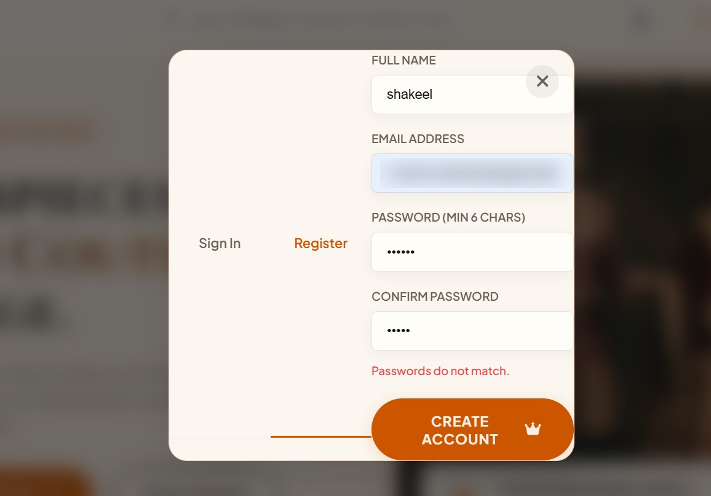
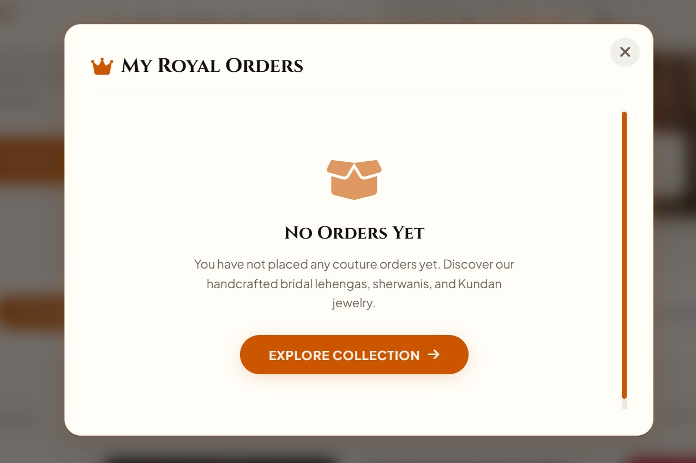
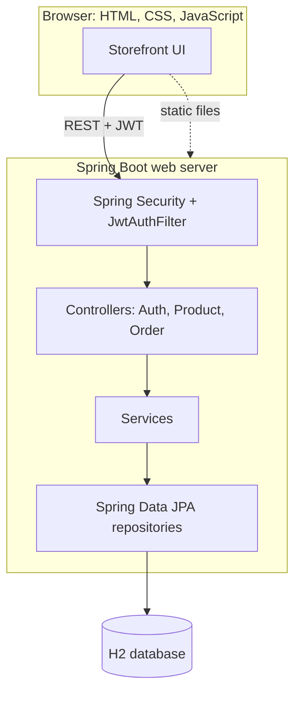
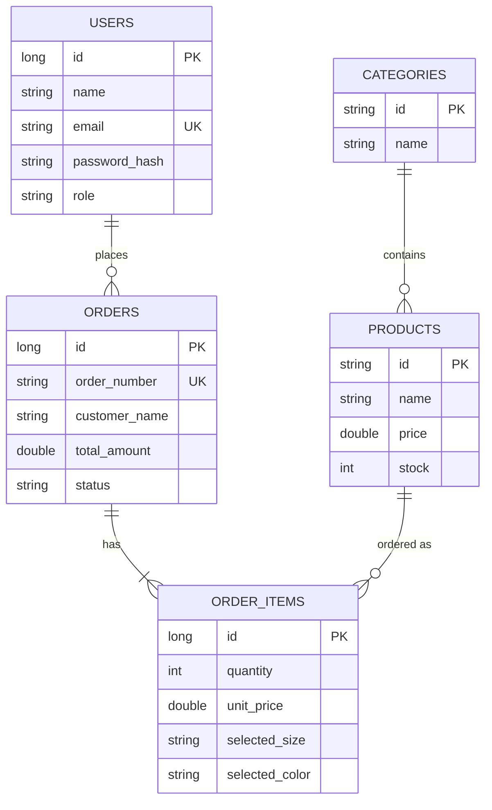

# Apna Store

[](https://github.com/mdshakeel-lab/ApnaStore/actions/workflows/ci.yml)

A full-stack e-commerce web app for Indian ethnic wear and jewelry, built with Java 17, Spring Boot 3, Spring Security (JWT), Spring Data JPA and a vanilla JavaScript storefront. Spring Boot serves both the REST API and the website from one port.

Learning project. Payments are simulated and the app currently runs locally. See [Project status](#project-status).

| Light theme | Dark theme |
|---|---|
|  |  |

| Shopping bag with free-shipping progress and promo code field |
|---|
|  |

| Register modal with field validation | My Orders view (orders of the logged-in user) |
|---|---|
|  |  |

## Features

- **Storefront**: category filters, instant search, product detail view, wishlist, cart drawer, step-by-step checkout, light/dark theme. Cart and wishlist are kept in `localStorage`.
- **Accounts**: register and log in, then view your own orders under "My Orders". Passwords are hashed with BCrypt and sessions use stateless JWTs.
- **Server-side order logic**: totals are calculated from database prices (prices sent by the browser are ignored), promo codes are validated on the server, and stock is checked and reduced inside one transaction.
- **Validation and errors**: request validation with Jakarta Bean Validation and a global exception handler. Every error uses the same JSON shape (`timestamp`, `status`, `message`, `fieldErrors`) with proper 400, 401, 403, 404 and 409 codes.
- **Database**: Spring Data JPA with H2 (file mode for development, in-memory for tests). A seeder loads 9 products and the categories on first start.
- **API docs**: interactive Swagger UI with Bearer-token authorization.
- **Tests**: unit tests (JUnit 5, Mockito), controller tests (MockMvc) and an end-to-end flow test.

> **Promo codes** (checked on the server): `APNA20`, `ROYAL20`, `LUMIERE20` give 20% off, `WELCOME10` gives 10% off, `ROYAL50` and `VIP50` give a flat 50 off. Shipping is free when the subtotal is above 300, otherwise 25.

## Tech stack

| Layer | Technologies |
|---|---|
| Backend | Java 17, Spring Boot 3.2.3, Spring MVC, Spring Data JPA (Hibernate) |
| Security | Spring Security 6, JJWT 0.12.6, BCrypt |
| Database | H2 (file mode for dev, in-memory for tests) |
| API docs | springdoc-openapi 2.3.0 (Swagger UI) |
| Validation | Jakarta Bean Validation |
| Build | Maven (Maven Wrapper included) |
| Testing | JUnit 5, Mockito, Spring Boot Test, Spring Security Test, MockMvc |
| Frontend | Vanilla JavaScript (ES6 modules), HTML5, CSS custom properties, Font Awesome, Google Fonts (Cinzel, Plus Jakarta Sans) |

## Architecture



Requests go through the JWT filter, then a controller, a service (business rules, transactions) and a repository. The same Spring Boot server also serves the files in `frontend/`.

## Data model



## API reference

| Method | Endpoint | Access | Description |
|---|---|---|---|
| `POST` | `/api/auth/register` | Public | Create an account and receive a JWT |
| `POST` | `/api/auth/login` | Public | Log in and receive a JWT |
| `GET` | `/api/products` | Public | List products. Optional params: `category`, `q`, `page`, `size`, `sort` |
| `GET` | `/api/products/{id}` | Public | Get one product |
| `GET` | `/api/products/categories` | Public | List categories |
| `POST` | `/api/orders` | Bearer token | Place an order (prices and promo are calculated on the server) |
| `GET` | `/api/orders/{id}` | Bearer token | Get an order by order number |
| `GET` | `/api/orders/my` | Bearer token | List the logged-in user's orders |
| `GET` | `/swagger-ui.html` | Public | Swagger UI |
| `GET` | `/v3/api-docs` | Public | OpenAPI JSON |

Send the token as `Authorization: Bearer <token>`.

## Getting started

Requirements: JDK 17 or newer and Git.

```bash
git clone https://github.com/mdshakeel-lab/ApnaStore.git
cd ApnaStore/backend
```

> Run it from the `backend` folder, because the server looks for the `frontend` folder next to it.

```powershell
# Windows PowerShell
.\mvnw.cmd spring-boot:run
```

```bash
# Linux / macOS
./mvnw spring-boot:run
```

On Windows you can also double-click `start-store.bat` in the project root.

Then open:

| What | URL |
|---|---|
| Storefront | http://localhost:8080/ |
| Swagger UI | http://localhost:8080/swagger-ui.html |
| H2 console | http://localhost:8080/h2-console |

H2 console login: JDBC URL `jdbc:h2:file:./data/apnastore`, user `sa`, empty password.

## Configuration

The app works with built-in development defaults. To use your own values, set these environment variables (see `.env.example`):

| Variable | Purpose |
|---|---|
| `APNASTORE_JWT_SECRET` | Key used to sign JWTs, at least 64 characters |
| `APNASTORE_JWT_EXPIRY_MS` | Token lifetime in milliseconds (default 24 hours) |
| `ADMIN_SEED_PASSWORD` | Password of the seeded admin account |

```powershell
$env:APNASTORE_JWT_SECRET="replace-with-your-own-random-string-of-at-least-64-characters"
$env:ADMIN_SEED_PASSWORD="choose-a-strong-password"
```

The built-in defaults are for local development only. Never use them for anything public.

## Try the API in Swagger

1. Open http://localhost:8080/swagger-ui.html.
2. Run `POST /api/auth/register` with a name, email and password (at least 6 characters). Copy the token from the response.
3. Click **Authorize**, paste the token and confirm.
4. Run `POST /api/orders` or `GET /api/orders/my`.

## Running the tests

```bash
cd backend
./mvnw test   # Windows: .\mvnw.cmd test
```

Tests use a separate in-memory H2 database, so they never touch your `data/` folder.

- **Service tests**: server-side pricing, the 20% promo, insufficient stock, stock reduction, password hashing, duplicate email, wrong password.
- **Controller tests (MockMvc)**: 401 without a token, 400 with `fieldErrors` for invalid input, 404 in the standard error format, product list returns 200.
- **Integration test**: register, log in, place an order with the token, then check the saved order and the reduced stock.

## Project structure

```text
ApnaStore/
├── backend/
│   ├── pom.xml
│   ├── mvnw, mvnw.cmd
│   └── src/
│       ├── main/java/com/apnastore/
│       │   ├── config/          # security, CORS, static files, OpenAPI, data seeder
│       │   ├── controller/      # Auth, Product, Order
│       │   ├── service/         # business logic
│       │   ├── repository/      # Spring Data JPA
│       │   ├── model/           # JPA entities
│       │   ├── dto/             # request and response objects
│       │   ├── exception/       # custom exceptions + global handler
│       │   └── security/        # JWT utility, filter, user details
│       └── test/                # unit, controller and integration tests
├── frontend/                    # index.html, styles.css, app.js, data.js, assets/
├── legacy/                      # ApnaStoreServer.java (framework-free HTTP server)
├── docs/                        # screenshots and project notes
├── .env.example
└── start-store.bat / run.bat / start-store.ps1 / stop-store.bat
```

## Project status

This is a learning project, and some parts are intentionally simple:

- **Payments are simulated**. The card form in checkout is a demo, and card details are never sent to the server.
- **Runs locally on H2**. A MySQL production profile, Docker and cloud deployment are planned but not finished.
- **No admin screens yet**. The `ADMIN` role exists and is used in the security rules, but product-management endpoints are not implemented.
- **Known improvements**: restrict order lookup to the order's owner, lock stock rows so simultaneous orders cannot oversell, store money as `BigDecimal` instead of `double`, and move the JWT out of `localStorage` for a real deployment.

## Roadmap

- [ ] Docker and docker-compose with MySQL
- [ ] Deploy to AWS (EC2 or Elastic Beanstalk with RDS)
- [ ] Admin endpoints for managing products
- [ ] Razorpay test-mode payments
- [x] GitHub Actions workflow for build and tests

## What I learned

- How a JWT login flow works end to end with Spring Security: filter, token, roles, 401 versus 403
- Layering a Spring Boot app into controller, service and repository, and keeping DTOs separate from entities
- Moving business rules (pricing, promo, stock) to the server instead of trusting the browser
- Validation and a global exception handler for consistent API errors
- Writing unit, slice and integration tests with isolated test data

## Legacy server

`legacy/ApnaStoreServer.java` is the first version of the backend: a small HTTP server written with only the JDK (`com.sun.net.httpserver`). It is kept as a reference for how routing, headers and JSON handling work underneath a framework.

---

Built by [Shakeel Gulamalisha](https://github.com/mdshakeel-lab).
